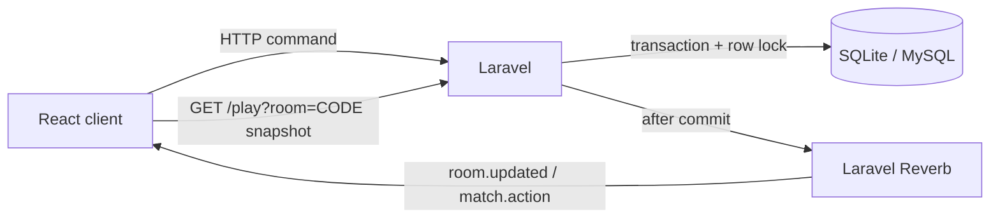

# Ludo Arena

[](https://laravel.com)
[](https://react.dev)
[](https://www.typescriptlang.org)
[](https://laravel.com/docs/reverb)

Ludo Arena is a mobile-first multiplayer Ludo web app. It supports 2-7 players per room, private invite-code rooms, computer opponents, 7 playable characters with generated sound effects and kill animations, server-authoritative rules, in-match chat, background music, reconnection, and a clean light visual system.

**No voice chat, no WebRTC audio, and no microphone permissions.**

> **Status: playable alpha.** The full loop works end to end: create or join a room, pick a home base color and character, ready up, start a server-authoritative match, roll and move with realtime sync over Reverb, chat, win, and reconnect after a refresh or session expiry. Quick matchmaking, turn timers, and the installable PWA layer are not implemented yet.

## Contents

- [Overview](#overview)
- [Current status](#current-status)
- [Tech stack](#tech-stack)
- [Implemented scope](#implemented-scope)
- [Game rules](#game-rules)
- [Architecture](#architecture)
- [Realtime](#realtime)
- [Requirements](#requirements)
- [Getting started](#getting-started)
- [Running with Laragon](#running-with-laragon)
- [Environment variables](#environment-variables)
- [Available commands](#available-commands)
- [Project structure](#project-structure)
- [Documentation](#documentation)
- [Testing](#testing)
- [Security and privacy](#security-and-privacy)
- [Accessibility and PWA](#accessibility-and-pwa)
- [Roadmap](#roadmap)
- [License](#license)

## Overview

Ludo Arena is designed around a large board (the classic 15x15 grid for up to 4 players, a wider multi-arm track for 5-7 players), player cards, a prominent dice action, and a restrained light interface. The board is the hero. Game objects stay colorful while the surrounding surfaces remain quiet and readable.

The game is server-authoritative:

- The server generates dice values with a CSPRNG (`random_int`).
- The server validates every legal move, capture, safe square, and finish inside a database transaction with a row lock on the room.
- Every accepted action carries a UUID `action_id` and an incrementing `state_version`.
- The authoritative match snapshot lives in `rooms.match_state`; every page load of `/play?room=CODE` restores the board from it.
- Clients send commands and apply versioned realtime events; on any gap or reconnect they reload the snapshot.

The initial product language is Indonesian, with English planned. The interface must remain usable with reduced motion, keyboard input, screen readers, and color-blind-safe status cues.

## Current status

| Area | Status |
|---|---|
| Laravel 13 + Inertia 3 + React 19 + TypeScript 5 | Working |
| Breeze authentication routes | Working |
| Tailwind CSS 4 and Vite 8 build | Working |
| Home, room lobby, and match board UI | Working |
| Server-authoritative match engine (roll, move, capture, finish) | Working; state snapshot on `rooms.match_state` |
| 2-7 player rooms with 7 seat colors and 7 characters | Working |
| Computer opponents with server-side autoplay | Working |
| Optional host advantage (biased dice) | Working |
| In-match chat with history | Working |
| Laravel Reverb realtime transport | Working; `room.updated` and `match.action` events on `room.{CODE}` |
| Reconnect, resume, and exit guard | Working; resume cookie, snapshot restore, `419` reload recovery |
| Character sound effects, BGM, and kill animations via OpenRouter generation | Working; assets stored under `public/assets` |
| Match result modal, winner quadrant stage, capture SFX and animations | Working |
| Quick matchmaking | Not started |
| Turn deadlines / 15-second timers | Not started |
| Outbox pattern and separate `matches` schema | Not started; single-snapshot design today |
| Board renderer | React/CSS/SVG board with CSS animation working; PixiJS/GSAP not started |
| PWA manifest and service worker | Not started |
| Match channel authorization | Working; private `room.{CODE}` channels with guest-aware membership auth |
| `php artisan test` | Feature suite present (pages, room flow, resume) — passing |
| TypeScript check | Passing |
| Database | SQLite locally, MySQL is the target |
| Queue and cache | Database locally, Redis is the production target |

## Tech stack

| Layer | Stack |
|---|---|
| Backend | PHP 8.3, Laravel 13, Inertia 3, Laravel Breeze, Sanctum, Ziggy 2 |
| Frontend | React 19, TypeScript 5, Vite 8, Tailwind CSS 4, Headless UI |
| Realtime | Laravel Reverb 1.x, Laravel Echo, `@laravel/echo-react`, `pusher-js` |
| Asset generation | OpenRouter audio and image models for character SFX, BGM, and kill animations |
| Planned game rendering | PixiJS and GSAP |
| Planned data services | MySQL 8, Redis, Horizon |
| Testing | Pest/PHPUnit, with Vitest and Playwright planned |

## Implemented scope

Working today:

- Password-gated room creation (server-verified), join by 6-character invite code, and guest entry without an account.
- Room lobby with host controls: capacity 2-7 players, host advantage toggle, fill seats with computer opponents.
- Home base color selection before character selection, unique per room, with 7 characters (Ignivar, Frostclaw, Solgarde, Verdantor, Umrax, Aqualon, Zephyira).
- Player name confirmation flow; the host can rename other players.
- Ready check and host-started matches with a random starting player.
- Server-authoritative roll and move commands under `lockForUpdate`, with `state_version` guards for computer turns.
- Classic 4-arm board (52 cells, 8 safe squares) and dynamic 5-7 arm boards (11-cell sectors, per-arm safe squares).
- Captures, extra turns, exact finish, forced opening six, full placements, and match finalization when one player remains.
- In-match chat with server-persisted history (`room_messages`) and throttled posting.
- Reconnection: resume token cookie (30 days), last-room memory, user fallback, and a board exit guard (refresh, back, and close confirmation).
- Match presentation: dice matched to the active turn color, token settle animation, capture SFX and kill animations, winner quadrant stage, background music.

Not yet implemented:

- Quick matchmaking by mode, ruleset, and region.
- PWA manifest, service worker, and offline banner.
- PixiJS/GSAP rendering and haptics.
- Separate `matches` / `match_actions` tables and the outbox publisher described in [ARCHITECTURE.md](ARCHITECTURE.md).

Explicit non-goals:

- Live voice chat, WebRTC audio, and microphone access.
- Real-money betting, cash-redeemable tokens, gambling, and NFTs.
- Offline multiplayer or offline move replay.
- Spectator mode, clans, and tournaments.
- Cross-device account synchronization while offline.

## Game rules

The ruleset lives in `app/Services/MatchRules.php` and is applied server-side only. Current decisions:

- 2-7 players, 4 tokens per player.
- A roll of 6 releases a token from base and grants another turn.
- Capturing an enemy token grants one extra roll; finishing a token grants another turn.
- An exact roll is required to finish.
- Tokens of the same color may share a cell. There are no blockades.
- Captures hit every enemy token on a non-safe cell.
- In local games and private rooms, three consecutive rolls without a 6 while all of a player's tokens are in base guarantee a 6 on that player's next roll. This also applies after all tokens return to base and to computer and timeout rolls. Quick Match has no guaranteed rolls.
- Full placements are tracked (`winners` in order of finishing); the match finalizes when only one player remains, ranking that player last.
- With the optional host advantage enabled, the host's dice are biased 50% toward a capture roll or a 6.
- 4-player matches use the classic 52-cell track with 8 safe squares (4 starts + 4 star cells); 5-7 player matches use a multi-arm track with 11-cell sectors and 2 safe squares per arm.
- A single legal move is executed automatically by the client when only one token can move.
- Computer opponents pick moves with a server-side heuristic (release from base, capture, finish, progress).
- No turn deadline blocks the game: each action (roll/move) gets 10 seconds. A timed-out turn is auto-played by the server (using the mode's dice rules, then a random legal move), so an AFK player never stalls the match. In Quick Match, three consecutive auto-played turns forfeit the seat to a computer (name and tokens stay); acting manually takes the seat back.

Open product decisions:

- Private-room rematch behavior.
- Guest session lifetime and account linking.
See [GAME_RULES.md](GAME_RULES.md) for the target ruleset and invariant list.

## Architecture

Ludo Arena is a modular monolith. Today the authoritative state is a single JSON snapshot on the `rooms` row (`rooms.match_state`): tokens, colors, arms, turn, dice, winners, per-player stats, `state_version`, and `started_at`.

Every mutating command (`roll`, `move`, seat/name/ready/start/end) runs inside a database transaction that re-reads the room with `lockForUpdate`, validates the action against the current state, increments `state_version`, and saves the snapshot. After commit, the server broadcasts the accepted action through Reverb; broadcast failures are logged but never roll back committed state.



Session continuity and accidental exit:

- `rooms.match_state` is the authoritative snapshot. `Play.tsx` restores it with a `RESTORE` action on every mount/refresh, so a running match never restarts at zero.
- `room_players.resume_token` plus the encrypted `ludo_resume_<CODE>` cookie (30 days, HttpOnly, SameSite=Lax) re-attach a browser to the seat it already owns after the Laravel session expires or the tab/browser closes. `ludo_last_room` remembers the last room code; authenticated users also fall back to `user_id`. Strangers never claim an occupied seat.
- `GET /room` without a code resumes the browser's last room (redirecting to `/play?room=CODE` when it is already running). `GET /play?room=CODE` sends waiting rooms back to the lobby and ended rooms home.
- `useGameExitGuard` blocks back/refresh/close while a match is live: `beforeunload` for refresh and tab close, a sentinel history entry plus `popstate` for the browser back button, and `ConfirmLeaveModal` for in-app links. Nothing leaves the page until the player confirms.
- A `419` from a roll/move (session expired mid-match) reloads the page, which re-attaches the saved seat and restores the board instead of losing the match.

The outbox pattern, idempotency-key table, and dedicated `matches` schema described in [ARCHITECTURE.md](ARCHITECTURE.md) remain the target design for scale; they are not required by the current single-snapshot model.

## Realtime

Laravel Reverb is installed, configured, and actively broadcasting:

- `BROADCAST_CONNECTION=reverb` with `ShouldBroadcastNow` events (no queue dependency for delivery).
- Echo configured once in `resources/js/app.tsx`.
- Two events on the private `room.{CODE}` channel:
  - `room.updated` — the full lobby payload, emitted on seat, name, ready, settings, start, end, and join changes.
  - `match.action` — one envelope per committed mutation (`roll`, `move`, `end`), carrying `action_id` (UUID), `player_id`, the dice value or `token_index`, `state_version`, and the full resulting `match_state`.
- Broadcast failures are caught and logged by `RoomBroadcaster` with room/action context; committed game state is never rolled back.
- The client applies an action only when it is the next expected event, ignores duplicates and stale versions, and falls back to the snapshot (page props) on reload.

Rate-limited HTTP APIs complement the socket: chat (30/min), client issue reporting (12/min), and the asset generation endpoints (3-15/min).

See [REALTIME.md](REALTIME.md) for the Reverb setup, channel authorization, envelope details, and production checklist.

## Requirements

- PHP 8.3 or newer.
- Composer 2.
- Node.js 20.19+ on the 20.x line, or 22.12+. Vite 8 does not support Node 21 or older 20.x releases.
- npm 10 or newer.
- MySQL 8 for the target game database. SQLite is supported for local scaffolding.
- Redis for the production queue, cache, matchmaking, and Reverb scaling.
- An OpenRouter API key, if you want to (re)generate character sound effects, background music, or kill animations. The game runs fine without one using the committed assets.
- Git.

## Getting started

Clone the repository:

```powershell
git clone https://github.com/berthojoris/ludo-online-web.git
cd ludo-online-web
```

Install dependencies and create the environment file:

```powershell
composer install
npm install
Copy-Item .env.example .env
php artisan key:generate
```

Configure `APP_URL` to match your local host, for example `http://ludo-app.test`.

### Database

SQLite is the default local scaffold:

```powershell
New-Item database/database.sqlite -ItemType File -Force
php artisan migrate
```

For MySQL, create a database and update `.env`:

```env
DB_CONNECTION=mysql
DB_HOST=127.0.0.1
DB_PORT=3306
DB_DATABASE=ludo_app
DB_USERNAME=root
DB_PASSWORD=
```

Then run:

```powershell
php artisan config:clear
php artisan migrate
```

MySQL is required for the final concurrency and row-lock behavior. Do not treat SQLite as production-equivalent.

### Build the frontend

For production assets:

```powershell
npm run build
```

For local hot reload:

```powershell
npm run dev
```

## Running with Laragon

Laragon serves the HTTP application. Point the virtual host document root to the `public` directory. Do not run `php artisan serve`.

Run these processes in separate terminals:

```powershell
# Terminal 1: WebSocket server
php artisan reverb:start --debug

# Terminal 2: frontend hot reload
npm run dev
```

For production assets, use `npm run build` instead of `npm run dev`.

After changing `.env`:

```powershell
php artisan config:clear
php artisan reverb:restart
```

Restart `npm run dev`, or rebuild with `npm run build`, after changing any `VITE_*` value.

### Testing from a phone

Set both `REVERB_HOST` and `VITE_REVERB_HOST` to the PC LAN IP, not `localhost`. Allow TCP port `8080` through the Windows firewall and keep the phone on the same network.

For HTTPS deployments, terminate TLS at a reverse proxy and set both `REVERB_SCHEME` and `VITE_REVERB_SCHEME` to `https`. A plain `ws://` connection from an HTTPS page will be blocked as mixed content.

## Environment variables

| Variable | Purpose | Local default |
|---|---|---|
| `APP_URL` | Public application URL | `http://localhost:8000` |
| `DB_CONNECTION` | Database driver | `sqlite` |
| `SESSION_DRIVER` | Session store | `database` |
| `CACHE_STORE` | Cache store | `database` |
| `QUEUE_CONNECTION` | Queue connection | `database` |
| `BROADCAST_CONNECTION` | Broadcast driver | `reverb` |
| `ROOM_CREATE_PASSWORD` | Server-verified password required to create a room | Required in every environment; room creation is disabled when empty |
| `OPENROUTER_API_KEY` | OpenRouter key for SFX, BGM, and kill animation generation | Empty; generation endpoints report not configured |
| `OPENROUTER_AUDIO_MODEL` | Audio model for SFX and BGM | `bytedance-seed/seed-audio-1-0` |
| `OPENROUTER_IMAGE_MODEL` | Image model for kill animations | `openai/gpt-image-2.6-sunburst` |
| `OPENROUTER_BASE_URL` | OpenRouter API base URL | `https://openrouter.ai/api/v1` |
| `REVERB_APP_ID` | Reverb application ID | Generated locally |
| `REVERB_APP_KEY` | Reverb public key | Generated locally |
| `REVERB_APP_SECRET` | Reverb secret | Generated locally |
| `REVERB_HOST` | Host Laravel uses to publish to Reverb | `localhost` |
| `REVERB_PORT` | Reverb server port | `8080` |
| `REVERB_SCHEME` | Reverb scheme | `http` |
| `REVERB_ALLOWED_ORIGINS` | Allowed WebSocket origins | `*` locally |
| `VITE_REVERB_APP_KEY` | Browser Echo key | Mirrors `REVERB_APP_KEY` |
| `VITE_REVERB_HOST` | Browser WebSocket host | Mirrors `REVERB_HOST` |
| `VITE_REVERB_PORT` | Browser WebSocket port | Mirrors `REVERB_PORT` |
| `VITE_REVERB_SCHEME` | Browser WebSocket scheme | Mirrors `REVERB_SCHEME` |

`.env` is ignored by Git. Never commit generated Reverb credentials, database passwords, the OpenRouter key, or application keys. `.env.example` contains placeholder credentials, not production secrets.

## Available commands

| Command | Purpose |
|---|---|
| `composer install` | Install PHP dependencies |
| `npm install` | Install Node dependencies |
| `php artisan migrate` | Run database migrations |
| `php artisan test` | Run the PHP test suite |
| `npx tsc --noEmit` | Type-check the frontend |
| `npm run build` | Build production assets |
| `npm run dev` | Start the Vite development server |
| `php artisan reverb:start --debug` | Start the Reverb WebSocket server |
| `php artisan reverb:restart` | Restart Reverb after configuration changes |
| `php artisan config:clear` | Clear cached configuration |

`npm run lint` is available, but it runs ESLint with `--fix` and may modify files.

## Project structure

```text
app/
  Events/                  RoomUpdated, MatchAction broadcast events
  Http/Controllers/        Room, chat, pages, auth, profile, and asset generation controllers
  Http/Middleware/         Inertia request handling
  Models/                  Room (match_state snapshot), RoomPlayer, User
  Services/
    MatchRules.php         Board spec, dice, moves, capture, computer heuristic
    RoomBroadcaster.php    Broadcast wrapper with failure logging
    PlayerResume.php       Resume token and last-room memory
    CharacterSoundGenerator.php, BackgroundMusicGenerator.php,
    CharacterKillAnimationGenerator.php  OpenRouter asset generation
config/
  broadcasting.php         Broadcast connections
  reverb.php               Reverb server and application credentials
  ludo.php                 Room creation password
database/
  migrations/              Users, rooms, room_players, room_messages, cache, jobs
  factories/               Model factories
  seeders/                 Database seeders
resources/
  css/app.css              Tailwind entry point and design tokens
  js/app.tsx               Inertia and Echo entry point
  js/Components/Game/      Board, dice, player cards, chat, modals, animations
  js/lib/ludo.ts           Board geometry and player configs
  js/lib/                  Board motion, sound, exit guard, viewport helpers
  js/Layouts/              Guest and authenticated layouts
  js/Pages/                Home, Play, Room, Dashboard, auth, and profile pages
  js/types/                TypeScript declarations
  views/app.blade.php      Inertia root template and CSRF meta
routes/
  web.php                  Home, how-it-works, play, room lobby, match, chat, and asset generation routes
  auth.php                 Authentication routes
  channels.php             Broadcast channel authorization
public/
  assets/                  Character art, pion figures, SFX, BGM, kill animations
tests/
  Feature/                 Page, room flow, and resume tests
  Unit/                    Unit tests
```

Planned game structure:

```text
app/Domain/Ludo/           Rules engine, actions, DTOs, events, exceptions
app/Domain/Rooms/          Room actions and policies
app/Domain/Matchmaking/    Queue actions and jobs
resources/js/features/     Game, room, matchmaking, and board features
tests/Unit/Domain/Ludo/    Rules and property-based tests
```

## Documentation

| Document | Contents |
|---|---|
| [PRD.md](PRD.md) | Product requirements, journeys, acceptance scenarios, and launch gates |
| [DESIGN.md](DESIGN.md) | Visual system, layout, tokens, components, and accessibility checklist |
| [ARCHITECTURE.md](ARCHITECTURE.md) | System boundaries, transaction model, timers, and failure modes |
| [ANIMATION.md](ANIMATION.md) | Animation sequences, timing, interruption, and performance budgets |
| [REALTIME.md](REALTIME.md) | Reverb setup, channel authorization, event envelope, and recovery |
| [GAME_RULES.md](GAME_RULES.md) | Versioned ruleset, board model, invariants, and test matrix |
| [PWA.md](PWA.md) | Installability, caching matrix, offline behavior, and mobile limitations |
| [TASKS.md](TASKS.md) | Executable P0/P1 work breakdown |
| [ROADMAP.md](ROADMAP.md) | Milestones and dependencies |

## Testing

Current baseline:

```powershell
php artisan test
npx tsc --noEmit
npm run build
```

The current suite covers rendered pages, the room join/seat/ready/start flow, and match resume/reconnect behavior (`GamePagesTest`, `RoomFlowTest`, `GameResumeTest`). The game test plan is broader:

- Pure rules engine tests for every dice value and board edge case.
- Property-based tests for invariants, captures, safe cells, and finish conditions.
- MySQL integration tests for locking, idempotency, and duplicate actions.
- Reverb integration tests for channel authorization and event delivery.
- Reconnect, visibility resume, duplicate event, and version gap tests.
- Playwright end-to-end tests for 2-7 player flows.
- Mobile device QA for 320px width, safe areas, and reduced motion.

## Security and privacy

- The server is authoritative. Client-provided dice, paths, and results are never trusted.
- Dice values use a CSPRNG (`random_int`).
- Every mutation re-reads the room under `lockForUpdate` inside a transaction.
- Room creation is gated by a server-verified password (`ROOM_CREATE_PASSWORD`); the value never reaches the browser bundle.
- Chat, client issue reporting, and asset generation endpoints are rate limited.
- The OpenRouter API key is server-only and never exposed to the client.
- Match events ride private `room.{CODE}` channels. The guest-aware `broadcasting/room-auth` endpoint authorizes room membership before Echo may subscribe.
- Roll and move commands are rate limited (60/min) in addition to the `state_version` and row-lock guards.
- `REVERB_ALLOWED_ORIGINS` must list explicit application origins outside local development.
- Reverb credentials and `.env` values must stay out of version control.
- Production requires HTTPS and WSS.
- SQLite is for local scaffolding only.
- No microphone permission is requested or required.

## Accessibility and PWA

The interface targets:

- No horizontal overflow at 320 CSS pixels.
- A square board that is never distorted or clipped.
- Touch targets of at least 44 CSS pixels where feasible.
- Safe-area support for notches and home indicators.
- Active-turn cues that do not rely on color alone.
- Reduced-motion support with animation skip and fast-forward behavior.
- A screen-reader equivalent for board status, active player, dice result, and legal moves.

The PWA scope (manifest, install icons, service worker, offline banner, update handling, and iOS install help) is not started. Match snapshots and actions are network-only. Offline clients may display the last-known board as a non-authoritative visual reference, but they must not replay moves.

## Roadmap

| Milestone | Scope | Status |
|---|---|---|
| M0 | Decisions, repository setup, build pipeline, authentication, realtime foundation | Done |
| M1 | Design system, responsive shell | Done; PWA manifest and service worker pending |
| M2 | Board renderer, Ludo rules engine | Done (CSS/SVG board, `MatchRules` engine); property tests pending |
| M3 | Rooms, seats, characters, computer opponents, server-authoritative actions | Done; quick matchmaking and idempotency keys pending |
| M4 | Realtime match events, snapshot recovery, reconnect | Done; timer synchronization pending |
| M5 | Board animation, SFX, kill animations, BGM | Done without PixiJS/GSAP; haptics pending |
| M6 | Security review, load tests, observability, backup restore, pilot release | Not started |

The next engineering milestones are quick matchmaking, turn timers with a timeout policy, and the installable PWA layer.

See [TASKS.md](TASKS.md) and [ROADMAP.md](ROADMAP.md) for the detailed work breakdown.

## License

The project license is not specified yet. The Laravel framework scaffolding is MIT licensed. Project-specific code, artwork, sound effects, and other assets require an explicit license before distribution.
