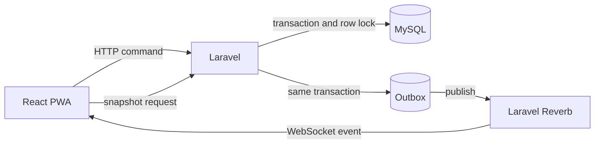

# Ludo Arena

[](https://laravel.com)
[](https://react.dev)
[](https://www.typescriptlang.org)
[](https://laravel.com/docs/reverb)

Ludo Arena is a mobile-first, installable multiplayer Ludo PWA. It targets 2-4 players, quick matchmaking, private invite-code rooms, server-authoritative rules, premium board animation, optional sound effects and haptics, reconnection, and a clean light visual system.

**No voice chat, no WebRTC audio, and no microphone permissions.**

> **Status: pre-alpha foundation.** The Laravel, Inertia, React, Reverb, and authentication foundation is in place. The responsive Home screen, CSS board, local practice match, and room lobby preview are implemented. The server-authoritative rules engine, match schema, and online matchmaking are not implemented yet.

## Contents

- [Overview](#overview)
- [Current status](#current-status)
- [Tech stack](#tech-stack)
- [MVP scope](#mvp-scope)
- [Game rules](#game-rules)
- [Architecture](#architecture)
- [Realtime](#realtime)
- [Requirements](#requirements)
- [Getting started](#getting-started)
- [Running with Laragon](#running-with-laragon)
- [Environment variables](#environment-variables)
- [Available commands](#available-commands)
- [Project structure](#project-structure)
- [Documentation](#documentation)
- [Testing](#testing)
- [Security and privacy](#security-and-privacy)
- [Accessibility and PWA](#accessibility-and-pwa)
- [Roadmap](#roadmap)
- [License](#license)

## Overview

Ludo Arena is designed around a large 15x15 board, two or four player cards, a prominent dice action, and a restrained light interface. The board is the hero. Game objects stay colorful while the surrounding surfaces remain quiet and readable.

The game is server-authoritative:

- The server generates dice values with a CSPRNG.
- The server validates every legal move, capture, safe square, and finish.
- The server owns turn deadlines and match results.
- Clients send commands with idempotency keys and expected state versions.
- Realtime events are versioned, deduplicated, and recoverable through a snapshot API.

The initial product languages are Indonesian and English. The interface must remain usable with reduced motion, keyboard input, screen readers, and color-blind-safe status cues.

## Current status

| Area | Status |
|---|---|
| Laravel + Inertia + React + TypeScript | Working |
| Breeze authentication routes | Working |
| Tailwind CSS 4 and Vite 8 build | Working |
| Laravel Reverb and Echo transport | Installed, configured, and verified locally |
| `php artisan test` | Passing |
| TypeScript check | Passing |
| Home, practice board, and room lobby UI | Working |
| Game rules engine | Not started; the practice board runs a local demo loop |
| Match, player, and action schema | Not started |
| Board renderer | React/CSS board working; PixiJS/GSAP not started |
| PWA manifest and service worker | Not started |
| Match channel authorization | Waiting for match schema |
| Database | SQLite locally, MySQL is the target |
| Queue and cache | Database locally, Redis is the production target |

The realtime transport is ready, but no gameplay event is broadcast yet. The `user.{userId}` private channel is authorized. The `match.{matchId}` channel will be enabled after `matches` and `match_players` exist.

## Tech stack

| Layer | Stack |
|---|---|
| Backend | PHP 8.3, Laravel 13, Inertia 2, Laravel Breeze, Sanctum, Ziggy |
| Frontend | React 18, TypeScript 5, Vite 8, Tailwind CSS 4 |
| Realtime | Laravel Reverb 1.13, Laravel Echo, `@laravel/echo-react`, `pusher-js` |
| Planned game rendering | PixiJS and GSAP |
| Planned data services | MySQL 8, Redis, Horizon |
| Testing | Pest/PHPUnit, with Vitest and Playwright planned |

## MVP scope

Planned P0 capabilities:

- Guest entry and authenticated accounts.
- Home screen with Play Online, Create Room, and Join Room.
- Private rooms with expiring invite codes and 2-4 seats.
- Quick matchmaking by mode, ruleset, and region.
- Ready and start flow with host controls.
- Server-side CSPRNG dice.
- Legal movement, base release, safe cells, capture, extra turns, and exact finish.
- 15-second action timers with timeout policy.
- Versioned realtime events and snapshot recovery.
- Reconnect, browser background resume, and stale-action protection.
- Premium dice, hop, capture, return-to-base, finish, and victory animation.
- Toggleable sound effects and feature-detected haptics.
- Installable PWA with safe-area support and offline status.
- Match results finalized idempotently on the server.
- Accessible controls, reduced motion, and Indonesian/English localization.

Explicit non-goals for the MVP:

- Live voice chat, WebRTC audio, and microphone access.
- Real-money betting, cash-redeemable tokens, gambling, and NFTs.
- Offline multiplayer or offline move replay.
- Spectator mode, clans, tournaments, and AI opponents.
- Cross-device account synchronization while offline.

## Game rules

The default ruleset is versioned per match. Current decisions:

- 2-4 players, 4 tokens per player.
- A roll of 6 releases a token from base.
- A roll of 6 grants another turn.
- Three consecutive sixes forfeit the current turn. The third six cannot be moved.
- Capturing an enemy token grants one extra roll.
- Eight safe squares: four starting cells and four star/shield cells.
- Tokens of the same color may share a cell. There are no blockades in the MVP.
- An exact roll is required to finish.
- A single legal move is executed automatically.
- Each action has a 15-second server deadline.
- Three consecutive timeouts mark the player as forfeited.
- Two-player quick match seats players in opposite quadrants. Private rooms may choose seats freely.
- No legal move advances the turn, subject to extra-turn rules.
- Resignation and forfeiture must follow one consistent terminal policy across all modes. A forfeited player cannot submit further roll or move commands.

Open product decisions:

- Winner-takes-all versus full placements for ranks 2-4.
- Private-room rematch behavior.
- Three-player quick-match queue and color assignment.
- Guest session lifetime, account linking, and reconnect after session expiry.

See [GAME_RULES.md](GAME_RULES.md) for the full ruleset and invariant list.

## Architecture

Ludo Arena starts as a modular monolith. HTTP commands mutate match state inside a database transaction. Accepted transitions are written to an outbox in the same transaction. A publisher sends committed events through Reverb. The client applies events by version and falls back to a snapshot when it detects a gap.



Core invariants:

- Exactly one current player in an active match.
- Every token belongs to exactly one participant.
- Only legal transitions alter state.
- `state_version` increments once per accepted command.
- The same idempotency key cannot apply two transitions.
- No capture on safe cells.
- A terminal match cannot accept roll or move commands.
- Reverb is transport only. MySQL remains the durable source of truth.

See [ARCHITECTURE.md](ARCHITECTURE.md) for transaction order, timer strategy, failure modes, and scaling notes.

## Realtime

Laravel Reverb is installed and configured. The current local transport uses:

- `BROADCAST_CONNECTION=reverb`.
- `config/broadcasting.php` and `config/reverb.php`.
- `routes/channels.php`, registered in `bootstrap/app.php`.
- Echo configured once in `resources/js/app.tsx`.
- Private channel authorization through `/broadcasting/auth`.
- A CSRF meta tag in `resources/views/app.blade.php`.

The realtime contract uses one composite `match.transitioned` event per committed mutation. Each event carries a schema version, event ID, action ID, state version, server timestamps, turn deadline, ordered visual effects, and optionally the authoritative state.

The client:

1. Fetches a snapshot and subscribes to the private match channel.
2. Applies only `lastAppliedVersion + 1`.
3. Ignores duplicate or stale versions.
4. Requests a snapshot and cancels stale animations on a version gap.
5. Re-fetches a snapshot on reconnect or visibility resume.
6. Never optimistically commits dice or movement.

See [REALTIME.md](REALTIME.md) for the full Reverb setup, channel authorization, event envelope, client algorithm, local verification, and production checklist.

## Requirements

- PHP 8.3 or newer.
- Composer 2.
- Node.js 20.19+ on the 20.x line, or 22.12+. Vite 8 does not support Node 21 or older 20.x releases.
- npm 10 or newer.
- MySQL 8 for the target game database. SQLite is supported for local scaffolding.
- Redis for the production queue, cache, matchmaking, and Reverb scaling.
- Git.

## Getting started

Clone the repository:

```powershell
git clone https://github.com/berthojoris/ludo-online-web.git
cd ludo-online-web
```

Install dependencies and create the environment file:

```powershell
composer install
npm install
Copy-Item .env.example .env
php artisan key:generate
```

Configure `APP_URL` to match your local host, for example `http://ludo-app.test`.

### Database

SQLite is the default local scaffold:

```powershell
New-Item database/database.sqlite -ItemType File -Force
php artisan migrate
```

For MySQL, create a database and update `.env`:

```env
DB_CONNECTION=mysql
DB_HOST=127.0.0.1
DB_PORT=3306
DB_DATABASE=ludo_app
DB_USERNAME=root
DB_PASSWORD=
```

Then run:

```powershell
php artisan config:clear
php artisan migrate
```

MySQL is required for the final concurrency and row-lock behavior. Do not treat SQLite as production-equivalent.

### Build the frontend

For production assets:

```powershell
npm run build
```

For local hot reload:

```powershell
npm run dev
```

## Running with Laragon

Laragon serves the HTTP application. Point the virtual host document root to the `public` directory. Do not run `php artisan serve`.

Run these processes in separate terminals:

```powershell
# Terminal 1: WebSocket server
php artisan reverb:start --debug

# Terminal 2: queued jobs (outbox publisher once implemented)
php artisan queue:work

# Terminal 3: frontend hot reload
npm run dev
```

For production assets, use `npm run build` instead of `npm run dev`.

After changing `.env`:

```powershell
php artisan config:clear
php artisan reverb:restart
```

Restart `npm run dev`, or rebuild with `npm run build`, after changing any `VITE_*` value.

### Testing from a phone

Set both `REVERB_HOST` and `VITE_REVERB_HOST` to the PC LAN IP, not `localhost`. Allow TCP port `8080` through the Windows firewall and keep the phone on the same network.

For HTTPS deployments, terminate TLS at a reverse proxy and set both `REVERB_SCHEME` and `VITE_REVERB_SCHEME` to `https`. A plain `ws://` connection from an HTTPS page will be blocked as mixed content.

## Environment variables

| Variable | Purpose | Local default |
|---|---|---|
| `APP_URL` | Public application URL | `http://localhost` |
| `DB_CONNECTION` | Database driver | `sqlite` |
| `SESSION_DRIVER` | Session store | `database` |
| `CACHE_STORE` | Cache store | `database` |
| `QUEUE_CONNECTION` | Queue connection | `database` |
| `BROADCAST_CONNECTION` | Broadcast driver | `reverb` |
| `REVERB_APP_ID` | Reverb application ID | Generated locally |
| `REVERB_APP_KEY` | Reverb public key | Generated locally |
| `REVERB_APP_SECRET` | Reverb secret | Generated locally |
| `REVERB_HOST` | Host Laravel uses to publish to Reverb | `localhost` |
| `REVERB_PORT` | Reverb server port | `8080` |
| `REVERB_SCHEME` | Reverb scheme | `http` |
| `REVERB_ALLOWED_ORIGINS` | Allowed WebSocket origins | `*` locally |
| `VITE_REVERB_APP_KEY` | Browser Echo key | Mirrors `REVERB_APP_KEY` |
| `VITE_REVERB_HOST` | Browser WebSocket host | Mirrors `REVERB_HOST` |
| `VITE_REVERB_PORT` | Browser WebSocket port | Mirrors `REVERB_PORT` |
| `VITE_REVERB_SCHEME` | Browser WebSocket scheme | Mirrors `REVERB_SCHEME` |

`.env` is ignored by Git. Never commit generated Reverb credentials, database passwords, or application keys. `.env.example` contains placeholder credentials, not production secrets.

## Available commands

| Command | Purpose |
|---|---|
| `composer install` | Install PHP dependencies |
| `npm install` | Install Node dependencies |
| `php artisan migrate` | Run database migrations |
| `php artisan test` | Run the PHP test suite |
| `npx tsc --noEmit` | Type-check the frontend |
| `npm run build` | Build production assets |
| `npm run dev` | Start the Vite development server |
| `php artisan reverb:start --debug` | Start the Reverb WebSocket server |
| `php artisan reverb:restart` | Restart Reverb after configuration changes |
| `php artisan queue:work` | Process queued jobs, including future outbox publication |
| `php artisan config:clear` | Clear cached configuration |

`npm run lint` is available, but it runs ESLint with `--fix` and may modify files.

## Project structure

```text
app/
  Http/Controllers/        Authentication and profile controllers
  Http/Middleware/         Inertia request handling
  Models/                  Eloquent models
config/
  broadcasting.php         Broadcast connections
  reverb.php               Reverb server and application credentials
database/
  migrations/              Current Laravel schema
  factories/               Model factories
  seeders/                 Database seeders
resources/
  css/app.css              Tailwind entry point and design tokens
  js/app.tsx               Inertia and Echo entry point
  js/Components/           Shared UI components
  js/Components/Game/      Board, dice, player card, logo, and icons
  js/lib/ludo.ts           15x15 board geometry and player configs
  js/Layouts/              Guest and authenticated layouts
  js/Pages/                Home, Play, Room, auth, and profile pages
  js/types/                TypeScript declarations
  views/app.blade.php      Inertia root template and CSRF meta
routes/
  web.php                  Home, practice board, room lobby, dashboard, and profile routes
  auth.php                 Authentication routes
  channels.php             Broadcast channel authorization
tests/
  Feature/                 HTTP and integration tests
  Unit/                    Unit tests
```

Planned game structure:

```text
app/Domain/Ludo/           Rules engine, actions, DTOs, events, exceptions
app/Domain/Rooms/          Room actions and policies
app/Domain/Matchmaking/    Queue actions and jobs
resources/js/features/     Game, room, matchmaking, and board features
tests/Unit/Domain/Ludo/    Rules and property-based tests
```

## Documentation

| Document | Contents |
|---|---|
| [PRD.md](PRD.md) | Product requirements, journeys, acceptance scenarios, and launch gates |
| [DESIGN.md](DESIGN.md) | Visual system, layout, tokens, components, and accessibility checklist |
| [ARCHITECTURE.md](ARCHITECTURE.md) | System boundaries, transaction model, timers, and failure modes |
| [ANIMATION.md](ANIMATION.md) | PixiJS and GSAP sequences, timing, interruption, and performance budgets |
| [REALTIME.md](REALTIME.md) | Reverb setup, channel authorization, event envelope, and recovery |
| [GAME_RULES.md](GAME_RULES.md) | Versioned ruleset, board model, invariants, and test matrix |
| [PWA.md](PWA.md) | Installability, caching matrix, offline behavior, and mobile limitations |
| [TASKS.md](TASKS.md) | Executable P0/P1 work breakdown |
| [ROADMAP.md](ROADMAP.md) | Milestones and dependencies |

## Testing

Current baseline:

```powershell
php artisan test
npx tsc --noEmit
npm run build
```

The repository currently has two scaffold tests. The game test plan is broader:

- Pure rules engine tests for every dice value and board edge case.
- Property-based tests for invariants, captures, safe cells, and finish conditions.
- MySQL integration tests for locking, idempotency, outbox ordering, and duplicate actions.
- Reverb integration tests for channel authorization and event delivery.
- Reconnect, visibility resume, duplicate event, and version gap tests.
- Playwright end-to-end tests for 2-4 player flows.
- Mobile device QA for 320px width, safe areas, and reduced motion.

## Security and privacy

- The server is authoritative. Client-provided dice, paths, and results are never trusted.
- Dice values use a CSPRNG.
- Commands use idempotency keys and expected state versions.
- Match channels are private and must verify current match membership.
- Room codes and invite links must not appear in public broadcasts.
- Rate limiting is required for room creation, joining, roll, move, and matchmaking.
- `REVERB_ALLOWED_ORIGINS` must list explicit application origins outside local development.
- Reverb credentials and `.env` values must stay out of version control.
- Production requires HTTPS and WSS.
- SQLite is for local scaffolding only.
- No microphone permission is requested or required.

## Accessibility and PWA

The interface targets:

- No horizontal overflow at 320 CSS pixels.
- A square board that is never distorted or clipped.
- Touch targets of at least 44 CSS pixels where feasible.
- Safe-area support for notches and home indicators.
- Active-turn cues that do not rely on color alone.
- Reduced-motion support with animation skip and fast-forward behavior.
- A screen-reader equivalent for board status, active player, dice result, and legal moves.
- Indonesian and English localization with externalized strings.

The PWA scope includes a manifest, install icons, a service worker, an offline banner, update handling, and iOS install help. Match snapshots and actions are network-only. Offline clients may display the last-known board as a non-authoritative visual reference, but they must not replay moves.

## Roadmap

| Milestone | Scope |
|---|---|
| M0 | Decisions, repository setup, build pipeline, authentication, realtime foundation |
| M1 | Design system, responsive shell, PWA manifest and service worker |
| M2 | Board fixture, pure Ludo rules engine, property tests |
| M3 | Match schema, rooms, matchmaking, atomic actions, idempotency, outbox |
| M4 | Private match channels, snapshot recovery, reconnect, timer synchronization |
| M5 | PixiJS board, GSAP animation, SFX, haptics, performance tuning |
| M6 | Security review, load tests, observability, backup restore, pilot release |

The next engineering milestone is the immutable board fixture, the versioned rules engine, and the match schema. Match channel authorization can be enabled immediately after the membership tables exist.

See [TASKS.md](TASKS.md) and [ROADMAP.md](ROADMAP.md) for the detailed work breakdown.

## License

The project license is not specified yet. The Laravel framework scaffolding is MIT licensed. Project-specific code, artwork, sound effects, and other assets require an explicit license before distribution.
